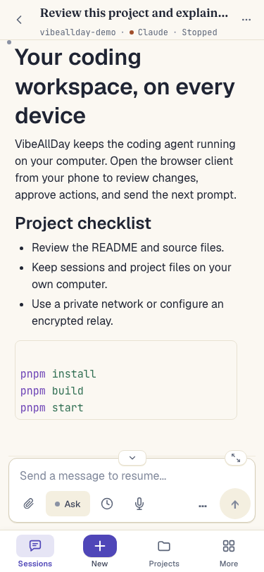
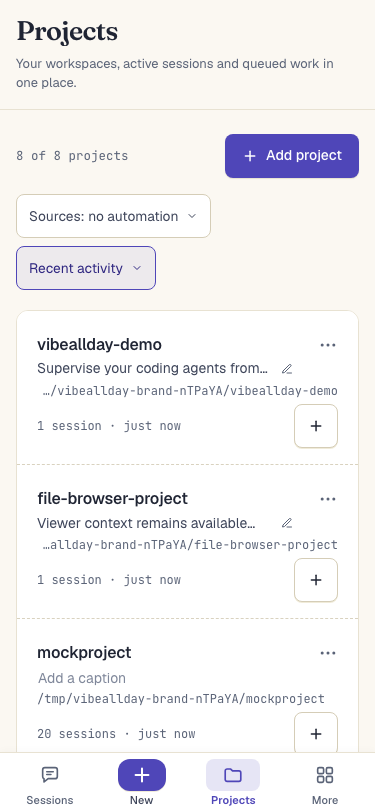
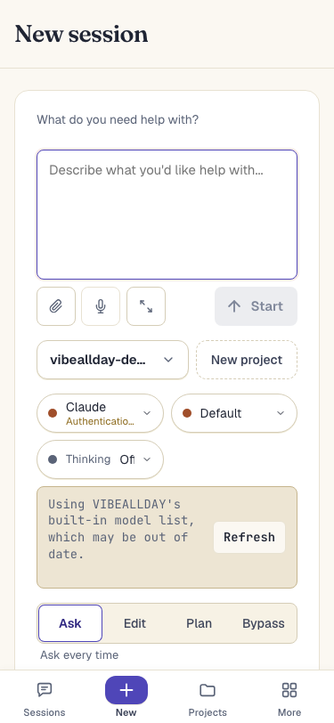
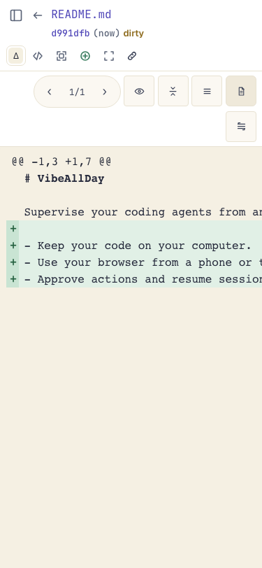
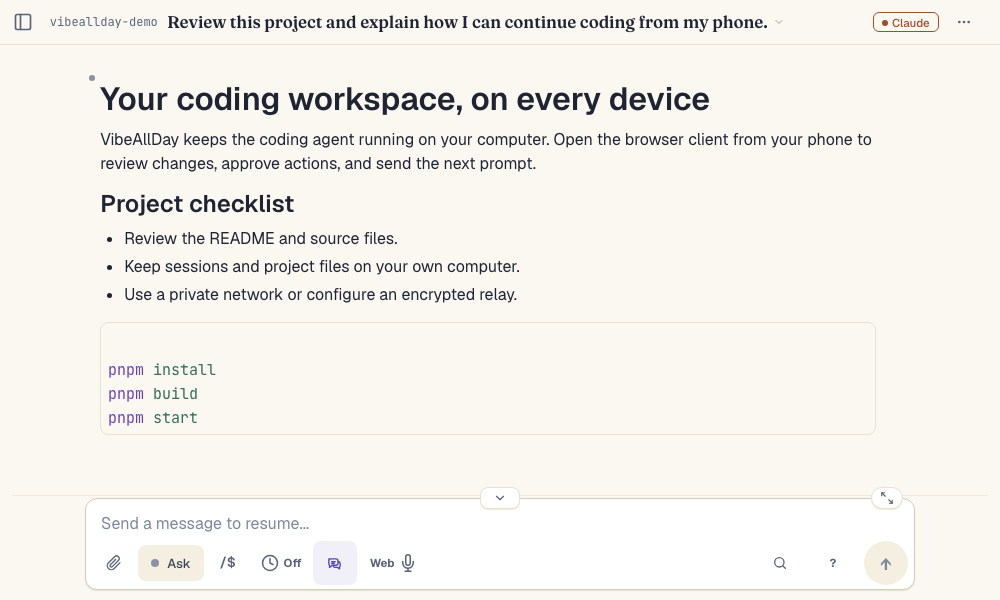
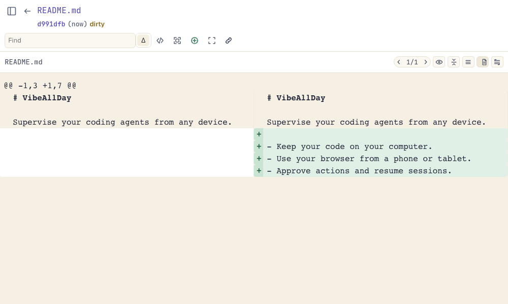

<p align="center">
  <picture>
    <source media="(prefers-color-scheme: dark)" srcset="site/public/branding/lockup-dark.svg">
    <source media="(prefers-color-scheme: light)" srcset="site/public/branding/lockup-light.svg">
    
  </picture>
</p>

<p align="center">
  <em>Mobile-first. End-to-end encrypted. Open source.</em>
</p>

<p align="center">
  <a href="https://vibeallday.navs.dpdns.org">vibeallday.navs.dpdns.org</a>
</p>

A complete browser interface for Claude Code and Codex. Start and supervise
agents from another computer, a tablet, or a phone while they run on the
machines you control.

Use an eligible Claude or ChatGPT plan through the account already signed in to
the official provider tool. VibeAllDay can also show current subscription
limits when the provider exposes them.

New server releases require Node.js `^22.16 || ^23.11 || >=24.10`. Existing
servers remain usable with the hosted client. See [runtime upgrade guidance](topics/server-runtime.md).

## Features

- **All your sessions, in one place** — Find and resume every Claude Code and
  Codex session, including those started from CLIs, VS Code, and first-party
  desktop apps. Disconnect or switch devices without interrupting active work.
- **See the whole session** — Follow the complete conversation, tool calls, and
  available thinking, or use a condensed view when you only need the result.
- **Work comfortably from a phone** — Approve tools, answer questions, upload
  files and photos, use voice input, and receive attention notifications.
- **Keep many agents organized** — See every project in one inbox, watch
  activity across sessions, steer active work, queue follow-ups, search older
  sessions, catch up with recaps, and fork or clone conversations.
- **Review and ship** — Browse files, diffs, and blame; send line comments to an
  agent; check remotes, fast-forward pull, push, or share a session read-only.
- **Control test devices remotely** — Stream Android devices and Apple
  Simulators with touch controls and adaptive quality.
- **Connect your way** — Use a direct connection or the end-to-end encrypted
  public relay, with no device pairing, VPN, or port forwarding required for
  the relay path.

See the [complete feature catalog](https://vibeallday.navs.dpdns.org/features) and
[public documentation](https://vibeallday.navs.dpdns.org/docs) for availability and setup.

## Supported Providers

| Provider | Diffs | Approvals | Streaming | Notes |
|----------|-------|-----------|-----------|-------|
| Claude Code | Full | Yes | Yes | Primary provider, full feature support |
| Codex | Full | Yes | Yes | Full support including diffs and approvals |

OpenCode, Grok Build, Gemini, and pi integrations are experimental. Claude
Gateway is an advanced opt-in route, while Claude + Ollama remains available
only for legacy compatibility. Capabilities vary. See the
[provider guide](https://vibeallday.navs.dpdns.org/docs/providers).

## Screenshots

<p align="center">
  
  
</p>
<p align="center">
  
  
  
</p>

**Works great on desktop too!**

<p align="center">
  
  
</p>

## Getting Started

If you can install Claude Code or Codex, you can install this. The runtime has a
narrow dependency surface.

VibeAllDay is currently available from source. Independent desktop installers,
mobile store listings, and the npm package have not been published yet.

```bash
git clone https://github.com/jiji262/vibeallday.git
cd vibeallday
pnpm install
pnpm build
pnpm start
```

Open http://localhost:3400 in your browser. The app auto-detects installed CLI agents.

**Keep the data directory on local disk.** VIBEALLDAY keeps a SQLite database in
`~/.vibeallday`, and SQLite takes a file lock per transaction. On a local disk
that lock is free. On a network home directory (NFS, SMB, or any mounted share)
each one is a network round trip, slow enough to stall the server. VIBEALLDAY checks at
startup and leaves the database closed on a share rather than stall, which costs
you issue associations and learned speech vocabulary until you move it. Point
`VIBEALLDAY_DATA_DIR` at local disk:

```bash
VIBEALLDAY_DATA_DIR=/scratch/$USER/.vibeallday pnpm start
```

The complete phone and tablet experience is the responsive browser client. A
native app should add more than an app-store wrapper, so Android is in
development around reliable background notifications, deep links, trusted
packaging, and a multi-server inbox, with iOS planned afterward. Neither is
published. Follow the
[getting-started guide](https://vibeallday.navs.dpdns.org/docs/getting-started) for the
current platform choices.

## Updating

For a source checkout:

```bash
git pull --ff-only
pnpm install
pnpm build
```

Then restart the server with `pnpm start`.

## Remote Access

**Easiest:** Use our free public relay when you want passworded,
end-to-end encrypted access from any browser. Configure it in Settings, or via
CLI for headless setups:

```bash
pnpm start --setup-remote-access --username myserver --password "secretpass123"
```

Then connect from anywhere at [vibeallday.navs.dpdns.org/remote](https://vibeallday.navs.dpdns.org/remote).

Remote Access application traffic is end-to-end encrypted, so the relay
cannot read session contents. Public session shares are a separate opt-in path:
the current relay operator can read shared content. No accounts are required.

Direct browser access has its own password under **Settings → Local Access**,
or `pnpm start --setup-auth "<password>"` for headless setup and recovery. See
[Local access and passwords](https://vibeallday.navs.dpdns.org/docs/local-access).

**Private network:** If you only need to reach a solo install from your phone,
a VPN such as Tailscale is usually simpler than deploying your own relay: put
the phone and dev machine on the same private network, then open the VibeAllDay
server from the phone.

**Self-hosted web access:** Prefer to run your own public infrastructure? Use
Caddy or any reverse proxy with SSL termination. See the
[remote access guide](https://vibeallday.navs.dpdns.org/docs/remote-access) for details.

## Why not just use the terminal?

You *can* use the terminal on your phone — but monospace text is painful on a small screen, there's no file upload, no push notifications, and no way to see all your sessions at once. This gives you a proper UI while keeping everything self-hosted and running your code locally.

## Comparison to Other Tools

There are a lot of projects in this space. We track them all: **[docs/competitive/all-projects.md](docs/competitive/all-projects.md)**

## Development

See [DEVELOPMENT.md](DEVELOPMENT.md) for build instructions, configuration
options, and contributor guidance. For deeper technical context, see the
[project architecture](ARCHITECTURE.md) and
[client rendering and performance guide](packages/client/RENDERING_PERFORMANCE.md).

## TOS Compliance

VibeAllDay uses the official [`@anthropic-ai/claude-agent-sdk`](https://www.npmjs.com/package/@anthropic-ai/claude-agent-sdk) published by Anthropic. We don't handle authentication, spoof headers, or manipulate OAuth tokens. You authenticate via your own Claude CLI — we're just a remote interface to your sessions.

Read more: [How we use the SDK](https://vibeallday.navs.dpdns.org/tos-compliance.html) | [Feb 2026 auth clarification](https://vibeallday.navs.dpdns.org/sdk-auth-clarification.html)

## Star History

<!-- Chart images come from star-history.dera.page, a third-party fork of
     star-history.com (source: https://github.com/Mubelotix/simrepo). The
     original stopped rendering when GitHub shut down its stargazer API. -->
<a href="https://star-history.dera.page/#jiji262/vibeallday&type=date&legend=top-left">
  <picture>
    <source media="(prefers-color-scheme: dark)" srcset="https://star-history.dera.page/svg?repos=jiji262/vibeallday&type=date&legend=top-left&theme=dark" />
    <source media="(prefers-color-scheme: light)" srcset="https://star-history.dera.page/svg?repos=jiji262/vibeallday&type=date&legend=top-left" />
    
  </picture>
</a>

## License

[MIT](LICENSE)
