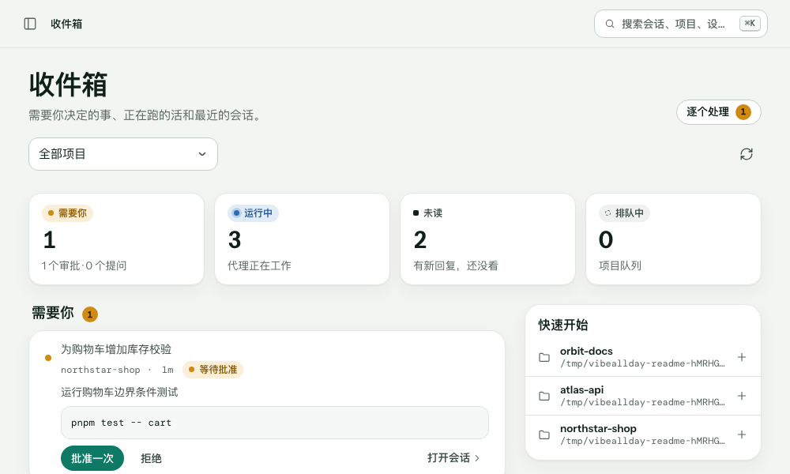
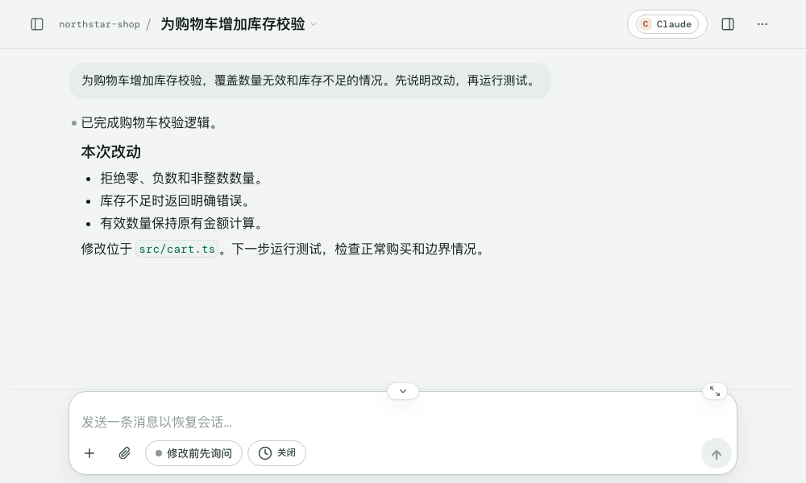
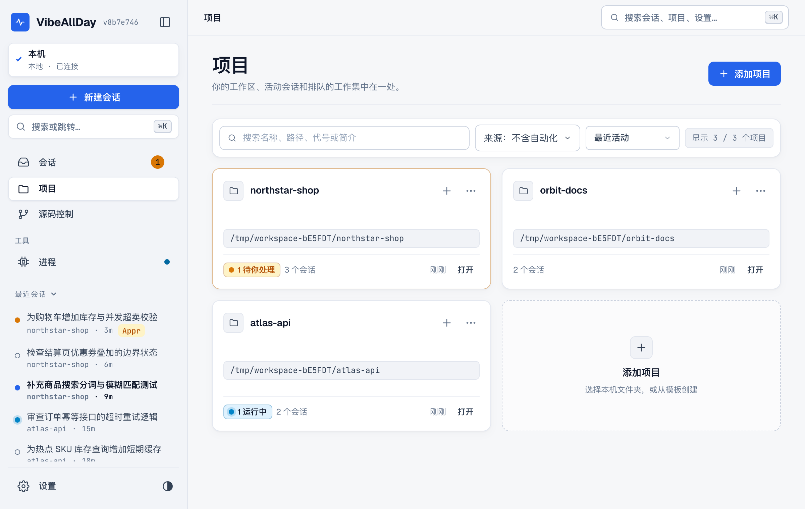
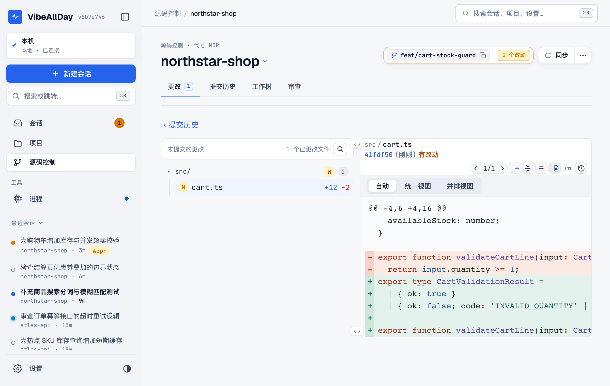
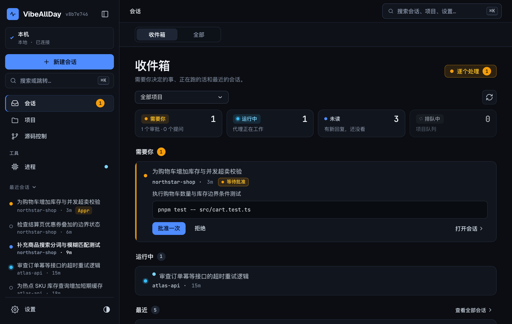
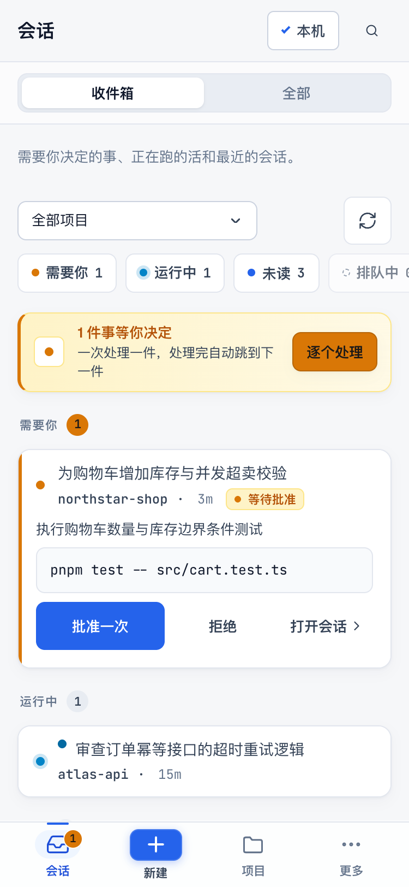
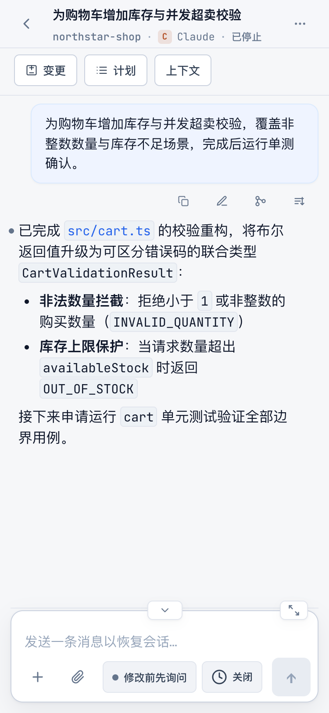
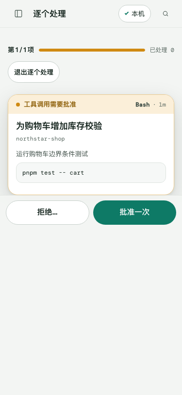
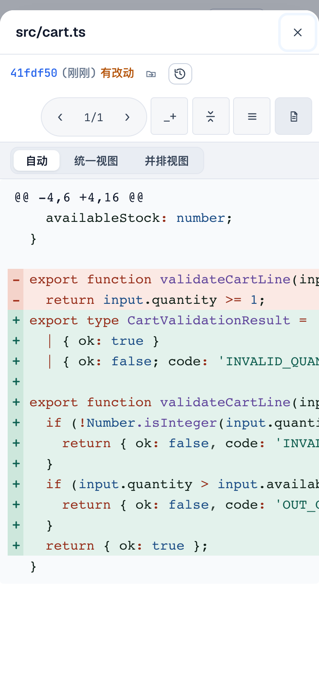

# VibeAllDay

**在电脑上运行编程 Agent，在任何浏览器里掌握进度。**

VibeAllDay 是一个自托管的 AI 编程会话工作台，主要支持 **Claude Code 和 Codex**。
把多个项目的会话、工具审批和代码审查放在同一个界面里，电脑、手机、平板都能用。
代码、凭据和 Agent 进程留在你控制的主机上；关掉网页后，服务端任务继续运行。



> 本页图片均由真实 Web 界面加载虚构数据生成。项目、对话、代码和运行状态仅作演示，不含真实业务数据。

[安装](#安装与启动) · [开始使用](#开始使用) · [手机访问](#从手机或其他电脑访问) · [与 HAPI 对比](#与同类工具相比) · [开发](#开发与更新)

## 解决什么问题

当你同时让几个 Agent 改代码、跑测试、做审查时，最费精力的往往是追踪工作、处理等待和找回上下文。

| 日常问题 | VibeAllDay 的做法 |
| --- | --- |
| 多个终端窗口来回切，不知道谁在等你 | 收件箱集中呈现待审批、运行中和未读会话，优先处理需要你决定的事 |
| 离开电脑后，任务卡在一次工具审批 | 在手机浏览器查看命令、批准或拒绝操作，也能继续发消息 |
| 历史散落在不同工具中，找回上下文麻烦 | 发现已有 Claude Code / Codex 会话，查看原始历史并恢复会话 |
| 想等同一项目里的工作结束，再安排审查 | 可选 Project Queue 等待项目空闲后逐项派发，避免只盯一个会话的完成状态 |
| Agent 说“改好了”，还得回电脑检查 | 在浏览器查看文件、Git diff 和历史，添加行级批注并交回 Agent 跟进 |

例如：电脑上的 Claude Code 修改购物车，Codex 审查 API；你离开桌面后，用手机处理审批，
回来再检查 diff。主机和服务需要保持运行；浏览器断开不等于 Agent 停止，主机休眠或关机仍会中断工作。

## 与同类工具相比

**VibeAllDay 更适合把浏览器作为日常工作台，集中管理多个项目、已有会话和审查任务。**

- **沿用已有工作记录**：直接读取 Claude Code / Codex 的原始会话历史，不必把日常工作全部改成专用启动命令。恢复时应避免多个客户端同时控制同一个会话。
- **项目级后续任务**：Project Queue 不只等待当前回复结束，还考虑同项目的活动会话、会话队列和空闲窗口；队列持久化，服务重启后先暂停，供你检查再继续。入口需在工具栏或输入框设置中启用，详见 [Project Queue](site/src/content/docs/project-queue.md)。
- **审查形成闭环**：Source Control 支持工作区和提交 diff、行级批注、汇总待提交意见，再把审查交给新会话或已有会话处理，详见 [文件与源码管理](site/src/content/docs/files-and-source-control.md)。
- **浏览器与自托管优先**：核心服务无需托管账号，手机使用同一套响应式 Web 界面；可选 Remote Access 使用 SRP 认证和端到端加密。
- **MIT 许可**：便于自行修改、部署和集成，遵循 [LICENSE](LICENSE) 保留相应声明。

### 与 HAPI 的定位差异

[HAPI](https://github.com/tiann/hapi) 同样提供本地运行、远程控制、多 Agent、审批和文件 diff。
这些是两者的共同能力。以下比较侧重工作方式，依据 HAPI 官方资料于 **2026 年 11 月**核对；产品能力会继续变化。

| 关注点 | VibeAllDay | HAPI |
| --- | --- | --- |
| 日常入口 | 浏览器工作台，以项目、会话收件箱和代码审查组织工作 | `hapi <agent>` 接入 Hub，强调本地终端与远程设备之间切换 |
| 会话记录 | 发现 Claude Code / Codex 已有原始历史，保留 provider 的续接方式 | CLI 注册会话，Hub 使用 SQLite 管理会话与消息 |
| 客户端方向 | 本分支专注本地服务与响应式 Web；不提供原生手机或桌面客户端 | 提供 Web / PWA、Telegram 集成以及原生 iOS / Android 客户端 |
| 开源许可 | MIT | AGPL-3.0-only |

HAPI 的终端交接、远程终端和原生通知适合希望延续终端工作方式的用户；
VibeAllDay 的侧重点是已有历史、项目级排队和浏览器内审查。
HAPI 的说明见 [工作原理](https://hapi.run/docs/guide/how-it-works) 与 [FAQ](https://hapi.run/docs/guide/faq)。
这不是性能排名，也不代表表中未列出的功能不存在。

相较只使用各家 CLI 或编辑器插件，本项目的价值是把跨 provider 的监督、审批与审查收拢到同一处，
并让手机也能参与。Claude Code、Codex 是主要支持对象；OpenCode、Grok Build、Gemini CLI、pi
等集成仍属实验性，模型、审批、历史与中途引导能力并不完全一致，见 [Provider 支持](site/src/content/docs/providers.md)。

## 界面预览

**会话详情**：把需求、Agent 回复、上下文侧栏（变更 / 计划 / 上下文 / 子代理）与继续对话放在同一视口。



**项目工作台**：集中查看本机代码仓库、待处理审批与运行中会话计数，快速发起新任务。



**代码审查**：检查真实渲染的 Git diff，支持统一/并排视图切换与行级批注，再把具体意见交回 Agent。



**深色工作台**：内置明亮与石墨深色两套 Studio Workbench 主题，长时间审阅代码与追踪长会话同样清晰。



### 手机上的使用流程

**查看进度与继续对话**：从收件箱找到需要关注的任务，打开会话阅读改动说明，再发送后续需求。

<p>
  
  
</p>

**处理审批与检查代码**：使用“逐个处理”模式核对即将运行的命令，在手机上批准或拒绝；打开 diff 抽屉检查具体修改。

<p>
  
  
</p>

## 安装与启动

当前可用方式是**从源码安装**；npm 安装包尚未发布，不要使用 `npm install -g vibeallday`。

### 1. 准备环境

- **Node.js**：推荐 Node.js 24 LTS；支持范围为 `^22.16 || ^23.11 || >=24.10`。
- **pnpm 10.34.6** 与 **Git**。未安装 pnpm 时可运行 `npm install --global pnpm@10.34.6`。
- 在运行服务的**同一台主机、同一用户**下，先安装并登录 [Claude Code](https://code.claude.com/docs/en/setup) 或 [Codex CLI](https://learn.chatgpt.com/docs/codex/cli)，至少一个可用。

先在终端运行 `claude` 或 `codex`，确认能正常对话，再启动 VibeAllDay。
Agent 访问模型所需的订阅或 API 费用仍由对应 provider 计费；本项目不提供模型额度。

### 2. 下载、构建、启动

```bash
git clone https://github.com/jiji262/vibeallday.git
cd vibeallday
pnpm install --frozen-lockfile
pnpm build
pnpm start
```

### 3. 打开工作台

在服务所在的电脑上打开 **<http://localhost:3400>**，保持启动服务的终端运行。
默认只监听本机 `127.0.0.1`。端口冲突时，macOS / Linux 可用 `PORT=4000 pnpm start`，
然后访问 `http://localhost:4000`；PowerShell 使用 `$env:PORT=4000; pnpm start`。

## 开始使用

1. **选择项目**：在 Projects（项目）中添加或选择本机代码目录；已发现的历史会话也可直接打开。
2. **新建会话**：选择 New session（新建会话），确认项目、provider、模型与权限模式，然后发送需求。
3. **处理等待**：在收件箱查看哪些会话需要审批；先检查命令或文件路径，再批准或拒绝。
4. **检查结果**：从会话中的文件链接或 Source Control（源码管理）查看改动，必要时添加批注继续迭代。
5. **安排后续**：当前会话的后续消息用普通队列；需要等待整个项目空闲的工作，启用 Project Queue 后加入项目队列。

流式输出、中途引导、附件和权限选项随 provider 能力变化。
详见 [会话与审批](site/src/content/docs/sessions-and-approvals.md)。

## 从手机或其他电脑访问

手机使用浏览器即可，不需要安装专用 App。**手机上的 `localhost` 指手机自身**，不能用它连接电脑。

| 方式 | 如何使用 |
| --- | --- |
| 局域网 / Tailscale | 先在 Settings → Local Access 配置访问密码，再将监听地址设为可达的网卡地址，通过主机 IP 和端口访问 |
| 加密 Remote Access | 在 Settings → Remote Access 配置用户名、强密码和 relay，启用后从对应远程 Web 入口登录，无需手动端口转发 |
| 自建 relay / HTTPS 反向代理 | 自行维护证书、认证、访问范围和服务更新，适合需要控制网络基础设施的用户 |

局域网监听示例（macOS / Linux，**先设置访问密码，再启动**）：

```bash
pnpm start --setup-auth "替换为你的长随机密码"
HOST=0.0.0.0 pnpm start
```

第一条命令设置密码后退出；第二条开始监听。浏览器打开 `http://电脑的局域网IP:3400`，
并按需放行主机防火墙。不要把未认证的服务直接暴露到公网。
完整配置与远程入口见 [远程访问](site/src/content/docs/remote-access.md) 和 [本地访问认证](site/src/content/docs/local-access.md)。

## 数据与隐私

设置、索引、上传文件、会话元数据和认证状态默认保存在 `~/.vibeallday/`
（Windows 为 `%USERPROFILE%\.vibeallday\`），可通过 `VIBEALLDAY_DATA_DIR` 指定其他目录。
Claude Code / Codex 原始会话仍保存在各自的数据目录。

普通 Remote Access 的应用消息端到端加密，relay 仍能看到连接时间、流量大小等元数据。
**公开只读分享不具备同等加密边界**；云端模型仍会按其服务规则接收你发送的提示和上下文。
详见 [安全与隐私](site/src/content/docs/security-and-privacy.md)。

## 开发与更新

```bash
pnpm dev           # 开发服务，默认端口 3400
pnpm lint
pnpm format:check
pnpm typecheck
pnpm test
```

浏览器测试先安装 Chromium：

```bash
pnpm --filter @vibeallday/client exec playwright install chromium
pnpm test:e2e
```

更新源码：先结束或妥善处理正在运行的任务，停止服务，再执行：

```bash
git pull --ff-only
pnpm install --frozen-lockfile
pnpm build
pnpm start
```

本地有修改时，先处理 Git 提示，不要覆盖自己的改动。完整说明见 [更新指南](site/src/content/docs/updating.md)。

开发约定见 [DEVELOPMENT.md](DEVELOPMENT.md)，更多使用指南见 [用户文档](site/src/content/docs/)。

`packages/server` 本地服务 · `packages/client` Web 界面 ·
`packages/shared` 共享协议 · `packages/relay` 可选远程 relay。

友情链接：[Linux DO](https://linux.do/)

[MIT License](LICENSE)
